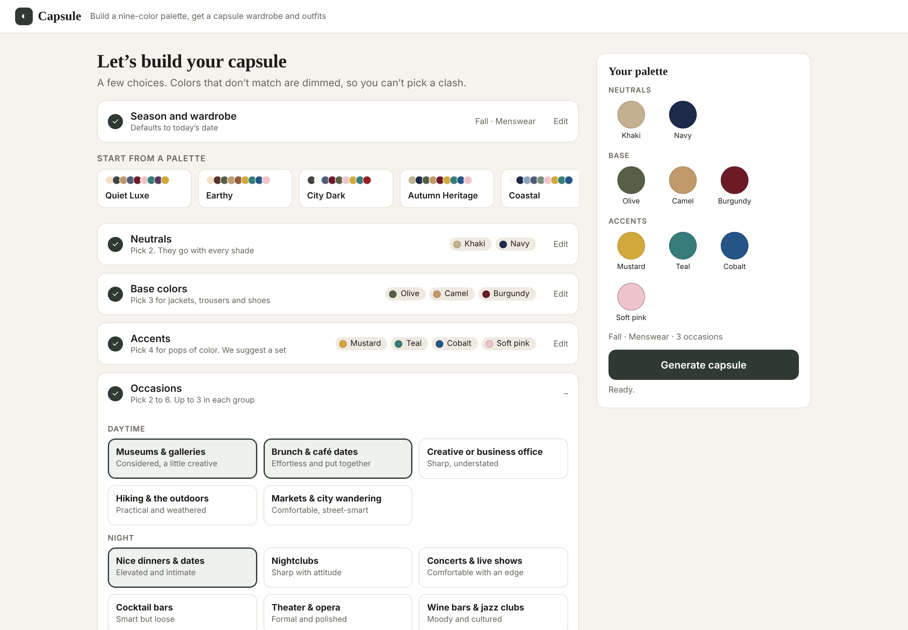
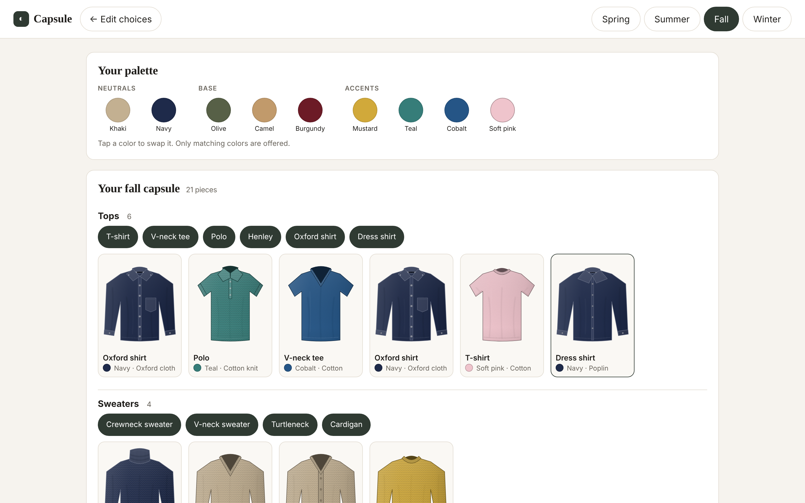
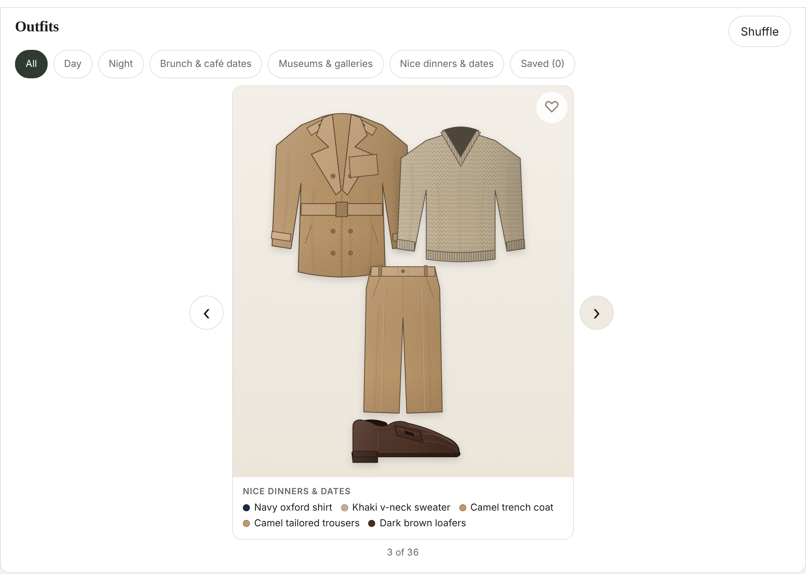

# 👔 Capsule Wardrobe Builder

Pick a season, a nine-color palette and the occasions you dress for. The app builds a ~21-piece capsule wardrobe for that season and generates outfits for each occasion, using only the pieces in the capsule.

### 1. Choose your season, palette and occasions


### 2. Get your capsule


### 3. Browse your outfits


## Features

- **Guided palette builder.** 2 neutrals, 3 base colors and 4 accents, following Anuschka Rees's wardrobe palette framework. Colors that would clash are dimmed with a reason, so you can't pick a palette that doesn't work.
- **6 ready-made palettes.** Quiet Luxe, Coastal, Earthy, City Dark, Soft Casual and Autumn Heritage, as one-click starting points.
- **13 occasions.** From brunch and museums to nightclubs, theater and hiking, each with its own formality range.
- **Seasonal capsule.** About 21 pieces across tops, sweaters, outerwear, bottoms and shoes, in fabrics that suit the season.
- **Outfit viewer.** Swipe through outfits, shuffle, save favorites, and filter by Day, Night or occasion.
- **Edit in place.** Swap a single piece (it stays pinned), swap a palette color (only matching colors are offered), or switch seasons.
- **Illustrated garments.** Shaded SVG illustrations recolored live to each piece's color.
- **Saves locally.** One capsule per season, kept in your browser.

## Method

The core problem: a capsule only works if **every piece goes with enough other pieces**. The app enforces that at three levels: the palette, the capsule and each outfit.

### 1. Palette: rules that guarantee everything mixes
`src/logic/gating.ts` checks a palette against the framework's rules:
- **Neutrals** must go with every other color in the palette.
- **Base colors** must all go with each other, and each needs at least 2 matching accents.
- **Accents** must each match at least 2 base colors.

Compatibility comes from a curated, symmetric color map of 23 colors (`src/data/compat.ts`). While you pick, a **lookahead** check tests whether your partial palette can still be completed. Any color that would lead to a dead end is dimmed with the reason, and accents are suggested once your base colors are set. If you change an earlier pick, later picks that no longer fit are removed and you're told which.

### 2. Capsule: the right pieces for the season and your occasions
`src/logic/capsule.ts` builds the wardrobe:
- **Season filter.** Only styles with a fabric valid for the season (linen in summer, wool in winter) are considered.
- **Color feasibility.** Each style has its own list of colors that make sense for it (no orange oxford shirts, no burgundy chinos), intersected with your palette. Shoes use a separate set of footwear colors such as dark brown or oxblood.
- **Ranking and quotas.** Styles are scored by how well their tags match your occasions, then picked up to a per-category quota.
- **Coverage guarantee.** Every chosen occasion must have enough pieces of the right formality in each layer an outfit needs. If not, pieces are added until it does.
- **Color balance.** Colors are spread across pieces so no single color dominates the capsule.

### 3. Outfits: valid combinations, then the best diverse set
`src/logic/outfits.ts` enumerates every top + bottom + shoes combination, plus a sweater and outerwear depending on the season (required in winter, optional in spring and fall, none in summer). A combination is rejected if:
- any two colors clash, or it uses **more than one accent**;
- the pieces' formality levels are too far apart (no sneakers with tailored trousers);
- layers don't physically work (no overshirt over a sweater, no blazer over a cardigan).

Survivors are scored on occasion fit, formality match, and color structure (a neutral + base + accent mix scores highest). A **diversity pass** then picks outfits that differ from each other and caps how often any one piece repeats. A seeded random generator keeps results reproducible while Shuffle gives a fresh set.

### 4. Tested
- **Unit tests (Vitest):** palette rules, gating, and capsule and outfit invariants. For example: every preset is a valid palette, a randomized sweep of the palette builder never reaches a dead end, no capsule ever contains an orange oxford or burgundy chinos, and shoes never take palette colors.
- **End-to-end tests (Playwright):** the manual path, the preset path and the mobile layout.

## Architecture

```
Choose screen ──► palette gating ──► capsule generation ──► outfit generation ──► Capsule screen
 (season, colors,   (rules + lookahead)  (season, feasibility,   (enumerate, filter,     (pieces, outfits,
  occasions)                              quotas, coverage)       score, diversify)       edit in place)
```

| Folder | What's in it |
|---|---|
| `src/data/` | Colors, compatibility map, presets, occasions, fabrics, piece catalog with allowed colors per piece |
| `src/logic/` | Palette gating, capsule generation, outfit generation, seeded random generator |
| `src/components/` | Choose screen, Capsule screen, shared UI |
| `src/store.ts` | App state (Zustand), saved to localStorage |
| `public/garments.js` | Shaded SVG garment illustrations, recolored by hex |
| `tests/`, `e2e/` | Unit and end-to-end tests |

## Getting started

Requires **Node.js 20.19+ or 22.12+**.

```bash
git clone https://github.com/dereklimz/capsule-wardrobe.git
cd capsule-wardrobe
npm install
npm run dev
```

Then open http://localhost:5173.

| Command | What it does |
|---|---|
| `npm run build` | Type-check and production build into `dist/` |
| `npm test` | Unit tests |
| `npm run e2e` | End-to-end tests (if Playwright can't find a browser: `CHROMIUM_PATH=/path/to/chrome npm run e2e`) |

## Limitations

- **Menswear only** in v1. Womenswear and Both are shown as "soon".
- **Curated rules.** Color compatibility and which colors suit each piece are hand-curated judgment calls. Edit `allowed` in `src/data/pieces.ts` to change them.
- **Approximate colors.** Hex values for khaki, camel and the footwear colors are named-color picks.
- **Illustrations, not photos.** Real product photos or trying clothes on your own photo are out of scope.

## Tech stack

TypeScript · React 19 · Zustand · Vite · Vitest · Playwright · plain CSS
